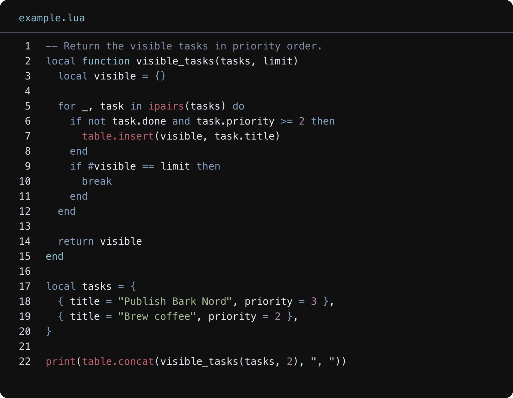

# Bark Nord

A dark Neovim colorscheme that pairs Bark’s highlight styles with Nord syntax
colors, a near-black background (`#101010`), and grayscale completion menus. It includes
highlights for blink.cmp, gitsigns.nvim, and Neo-tree.

Requires Neovim 0.9 or newer. Use a terminal with true-color support.



## Installation

### lazy.nvim

```lua
{
  "menshikow/bark-nord.nvim",
  lazy = false,
  priority = 1000,
  config = function()
    vim.opt.termguicolors = true
    vim.cmd.colorscheme("bark-nord")
  end,
}
```

### Native packages

Clone the repository into a package directory on Neovim’s `packpath`. The
default data directory on Linux and macOS is `~/.local/share/nvim`.

```sh
git clone https://github.com/menshikow/bark-nord.nvim.git \
  "${XDG_DATA_HOME:-$HOME/.local/share}/nvim/site/pack/themes/start/bark-nord.nvim"
```

Add this to your `init.lua` (or run `:colorscheme bark-nord` to try it).

```lua
vim.opt.termguicolors = true
vim.cmd.colorscheme("bark-nord")
```

## Credits

prod. if-not-nil, lung, menshikow

Bark Nord uses [Bark](https://github.com/if-not-nil/bark) and the
[Nord palette](https://www.nordtheme.com/docs/colors-and-palettes/).
The bundled Bark source comes from commit
[`2492f3f`](https://github.com/if-not-nil/bark/tree/2492f3f3c67e65214d0b75f2bc41b718d690df64).
See [LICENSE](LICENSE) for Bark’s upstream terms.
